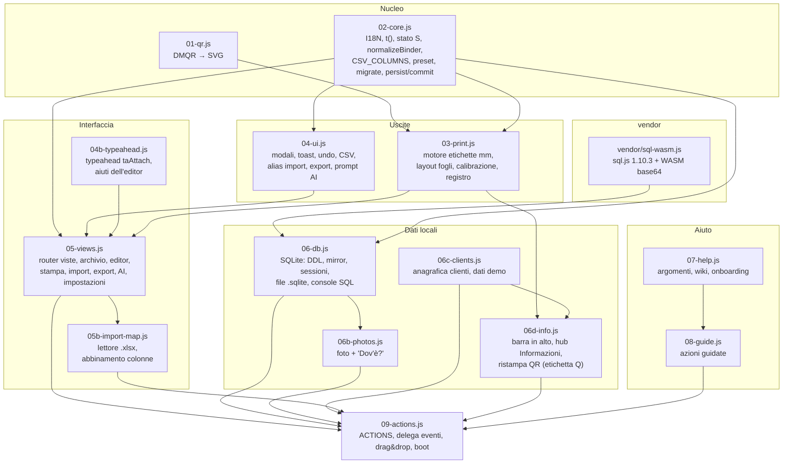

# DocMap 2026 — Architettura

Documento tecnico sulla versione **v8** (`APP_VERSION 26.8.0`, schema stato `26.8`, `DB_SCHEMA_VERSION 4`). Le differenze rispetto alla v7 sono riassunte nel §10.
Per le regole operative degli agenti vedi `../AGENTS.md`; per i formati dati `MODELLO-DATI.md`.

## 1. In una frase

DocMap è una **single-page app offline**: un `index.html` con script classici che si apre con doppio clic (`file://`), tiene tutti i dati nel browser (stato JSON in localStorage + copia SQLite in IndexedDB), stampa etichette al millimetro con QR statici `https://qr7.it/{short_code}` ed esporta CSV, JSON, manifest qr7.it e file `.sqlite`.

Nessun server, nessuna build, nessuna dipendenza di rete. sql.js (SQLite in WebAssembly) e i font sono inclusi nella cartella.

## 2. Moduli



L'ordine di caricamento in `index.html` è quello della numerazione (0 vendor → 09 actions). Gli script **non** sono moduli ES: ogni `const`/`function` di primo livello è globale. I file successivi estendono i precedenti (`Object.assign(I18N.it, …)`, `Object.assign(ACTIONS, PHOTO_ACTIONS, CLIENT_ACTIONS, IMPORT_MAP_ACTIONS, EDITOR_ACTIONS, INFO_ACTIONS)`). Alcune funzioni sono usate in avanti, solo al momento della chiamata: `renderTopbar()` (05) chiama `topbarHTML()` e `infoApplyCatColors()` (06d), `renderLabel()` (03) delega l'etichetta `Q` a `renderQrLabel()` (06d), l'archivio filtra con `infoMatch()` (06d). Gli argomenti di aiuto di 05b e 06d vengono aggiunti a `HELP_TOPICS` su `DOMContentLoaded`. Il boot è in fondo a `09-actions.js`.

### Avvio

```
loadState()          localStorage → migrate()  (se vuoto: stato di default + 5 faldoni demo)
ensureIntegrity()    id / codici parlanti / short code unici e validi
persist()            riscrive localStorage
renderAll()          banner + topbar (3 schede + menu ⚙) + vista corrente
maybeOnboard()       primo avvio: scelta di una guida
dbInit()             sql.js → apre la copia IndexedDB → dbMigrate → dbSyncFromState → dbPersist
window.DocMap = {…}  aggancio per i test
```

## 3. Flusso dei dati

```mermaid
sequenceDiagram
  participant U as Utente
  participant V as Vista / ACTIONS
  participant S as Stato S (memoria)
  participant LS as localStorage
  participant DB as SQLite (sql.js)
  participant IDB as IndexedDB / file .sqlite
  participant F as File esportati

  U->>V: modifica (editor, import, elimina…)
  V->>S: muta S (normalizeBinder, ensureIntegrity)
  V->>S: commit() → hasUnexportedChanges = true
  S->>LS: persist() 'docmap_v26_state' (+ copia '…_prev')
  S-->>DB: dbScheduleSync() dopo 700 ms → dbSyncFromState()
  DB->>IDB: dbPersist() (chiave 'db'; file collegato se permesso)
  U->>V: Esporta
  V->>F: CSV / JSON / manifest / .sqlite → markExported()
```

Principi:

- **Lo stato `S` è la fonte di verità.** SQLite è uno specchio ricostruito per intero a ogni sincronizzazione (DELETE + INSERT in una transazione). Fanno eccezione **foto** e **sessioni**, che esistono solo nel database.
- **Undo a un livello** per le operazioni di massa (elimina, import, ripristino sessione, apertura `.sqlite`): `undoPoint()` salva una copia, `undoToast()` offre "Annulla".
- **Indicatore "da esportare"**: ogni `commit()` lo accende, ogni export lo spegne; chiudendo la scheda con modifiche non scaricate il browser avvisa.
- **Più schede**: l'evento `storage` rileva modifiche fatte in un'altra scheda e mostra un banner "Ricarica".

## 4. Livelli di memorizzazione

| Livello | Dove | Contenuto | Note |
|---|---|---|---|
| Stato di lavoro | `localStorage['docmap_v26_state']` | tutto `S` in JSON (faldoni, clienti, impostazioni, stampa, preset, usedSlots, `infoTab`, `printPrev`) | copia precedente in `docmap_v26_state_prev`; usata se il JSON è corrotto o con "Ripristina snapshot precedente" |
| Copia SQLite | IndexedDB `docmap_v26_sqlite`, store `kv`, chiave `db` | byte del database (specchio + foto + sessioni + audit_log) | chiave `handle`: FileSystemFileHandle del file collegato |
| File `.sqlite` collegato | disco (Chrome/Edge, File System Access API) | stesso database, salvato a ogni sync | serve il permesso di scrittura; dopo un riavvio si riconferma |
| `docmap_AAAAMMGG_HHMM.sqlite` | download | database completo con foto e sessioni | il formato più completo |
| `docmap_workspace.json` / `docmap_workspace_AAAAMMGG_HHMM.json` | download | workspace completo **senza foto** (senza `infoTab` e `printPrev`, che restano solo in localStorage) | backup rapido; reimportabile con "ripristina tutto" |
| `docmap_full_backup.csv` | download | faldoni, 27 colonne, `;`, BOM UTF-8 | apribile in Excel, reimportabile |
| `manifest_qr7_dm26.csv` / `manifest.csv` | download | `short_code;short_url;final_destination;tags;` (ogni riga termina con `;`, v11) | per il server di redirect qr7.it |
| `docmap_clienti.csv` | download | anagrafica clienti | |

Tutte le copie di DocMap aperte da `file://` sullo stesso PC e browser condividono localStorage e IndexedDB.

## 5. Motore di stampa (`03-print.js`)

### Principi

- Tutto in **millimetri**. `MM(n)` produce stringhe `"12.5mm"`. Il foglio è un `div.sheet` 210×297 mm; il `<style id="page-style">` impone `@page{size:210mm 297mm;margin:0mm}` (il registro usa margini 10/10/12/10 mm).
- La stampa avviene nella pagina stessa: `doPrint()` scrive i fogli in `#print-root`, chiama `window.print()` e ripulisce su `afterprint`.
- Offset di calibrazione `S.print.offsetX/offsetY` (mm) spostano l'intero foglio (`sheetWrap`).
- Font inclusi (Inter, JetBrains Mono) → misure identiche su ogni PC.
- `LM` raccoglie le misure dell'ultima etichetta (QR, altezza codice, testo minimo) per il riquadro "Qualità di stampa" (QR ≥ 15 mm consigliato).

### Preset

`BUILTIN_PRESETS` (02-core) — ogni preset: `id, kind ('die'|'full'|'custom'), name, w, h, cols, rows, marginTop, marginLeft, gapX, gapY, radius, cut` e facoltativi `group`, `turn`, `popular`, `recommended`.
`geoFromPreset(p)` produce `S.print.geometry` (`GEO_KEYS` + `cut`, `group`, `turn`). Modificare la geometria accende `geometryModified`; "Salva come preset" crea `{id:'custom-…', kind:'custom', name, …geometry}` in `S.customPresets`.

Ordine: MRINK143 (predefinito), L7160, L7163, L7165, L7173 (più usati), poi altri Avery fustellati (L7161, L7159, L7162, L7169, L4760, L4761, L7167) e A4 adesivo intero da tagliare (`a4-8`, `a4-14`, `a4-10`, `a4-21`, `a4-5s`, `a4-4s`, con `cut:true`).

### Modalità di contenuto

`S.print.contentMode` → tipi di etichetta (`modeKinds`):

| contentMode | Tipi | Renderer |
|---|---|---|
| `split` (predefinito) | `S` — etichetta completa | `renderFull()` (se lo slot è orizzontale ricade su `U`) |
| `pair` | `A` + `B` consecutive | `renderLabel('A'|'B')` |
| `a` | `A` frontale (cliente, codice, posizione, QR) | template `classic` / `multi` / `bold` / `minimal` |
| `b` | `B` contenuti + data aggiornamento | |
| `u` | `U` unificata | |
| `qr` | `Q` — solo QR + codice parlante + codice breve (+ cliente se c'è spazio) | `renderQrLabel()` (06d-info.js); si adatta a qualsiasi casella, usata dalla "Ristampa solo QR" |

Campi stampabili dell'etichetta completa: `DEFAULT_FIELDS = {category, city, multi, url, title, year, contents, tags, extra, location, contacts:false, notes:false, date:'created'|'updated'|'none', empty:false}` (tutti `true` salvo dove indicato), sovrascrivibili in `S.print.fields`. Contatti e note sono spenti per default e compaiono solo nell'etichetta completa `S`. Le voci di contenuto con stato `in_use` / `client` ricevono un piccolo segno "↗ in uso" / "↗ cliente" nell'elenco contenuti; il Registro Generale non mostra lo stato. Con `empty:true` i campi vuoti diventano "Campo: ____" da compilare a mano; altrimenti non lasciano spazio. Il tag `demo` non viene mai stampato.

### MRINK143: 8 etichette 105×74 in 4 etichette fisiche 105×148

```
preset mrink143: w 105, h 74, cols 2, rows 4, group 2, turn true,
                 marginTop 0.5, marginLeft 0, gap 0, radius 0, cut false
```

- Il foglio A4 ha **4 etichette fisiche A6 105×148** (2×2). Ogni etichetta fisica contiene **2 etichette stampate complete** (`group: 2`) da 105×74, separate a mano con la taglierina: 8 per foglio.
- **Cornice di lettura** (`turn: true`): l'etichetta si legge con il foglio girato. `frameGeo(g)` scambia larghezza e altezza (74 × 105) e `renderSlotLabel()` ruota il contenuto: con `S.print.split.rotate = -90` (predefinito) `translateY(h) rotate(-90deg)`, con `+90` `translateX(w) rotate(90deg)`.
- **Ordine delle caselle** (`slotSeq()`): segue la lettura del foglio girato, quindi le etichette 1 e 2 sono le due metà della prima etichetta fisica. Indici di slot (riga × 2 + colonna, 0 = in alto a sinistra sul foglio in stampante):

| rotazione | ordine di riempimento (indici slot) |
|---|---|
| −90° (predefinita) | 6, 4, 2, 0, 7, 5, 3, 1 |
| +90° | 1, 3, 5, 7, 0, 2, 4, 6 |

  Per preset con `group > 1` non girati l'ordine va per etichetta fisica (prima entrambe le metà, poi la successiva); senza `group` è riga per riga.
- **Guide**: contorno dell'etichetta fisica solo a schermo (`.phys-scr`); linea di taglio tratteggiata chiarissima tra le metà (`.cut-line`, disattivabile con `S.print.split.guides=false`).
- **Anteprima** verticale come il foglio in stampante; `S.print.pvLandscape` gira solo l'anteprima.
- Migrazione v7: chi aveva la vecchia geometria 105×148 riceve una volta la nuova geometria e la mappa slot azzerata.

### Fogli parziali

`S.usedSlots[presetId]` = array di indici di slot già staccati. `layoutLabels()` salta quelle caselle **solo sul primo foglio**; un foglio segnato tutto usato vale come foglio nuovo. Dopo la stampa `printLabels()` propone di aggiornare la mappa con le caselle consumate dell'ultimo foglio.

### Calibrazione e registro

- `buildCalibSheet()`: prova "quasi bianca" (linee `#D1D5DB` da 0,25 pt, micro-testo, croci agli angoli, barra 50 mm per la scala 100%, coordinate X/Y di ogni slot).
- `buildRegisterHTML(list)`: Registro Generale d'Archivio A4 con codice, posizione, cliente, contenuti, QR, short code e URL.

### Ristampa solo QR (Informazioni › QR, `06d-info.js`)

- Elenco dei QR di tutti i faldoni (rispetta "nascondi esempi"), ricerca `UI.qrq`, selezione `UI.qrSel` (Set di id), paginazione da 120 (`UI.qrLimit`), download del singolo QR in SVG (512 px) o PNG (1024 px), file `qr_<speaking_code>_<short_code>`.
- Foglio scelto in `S.settings.qrPreset`: `l7159` (predefinito, 24 etichette 63,5×33,9), `l7160`, `l7162`, `l7163`, `a4-21`, `a4-14` o un preset personalizzato.
- `qrReprint()` salva **una sola volta** la stampa corrente in `S.printPrev = {presetId, geometry, geometryModified, contentMode, sel:[id], at}`, mette in coda solo i faldoni scelti, imposta il preset QR, `contentMode = 'qr'` e `qrMode = 'live'`, e apre Stampa etichette. Una barra in cima alla stampa offre **Ripristina** (`qrRestorePrint()`) o **Tieni queste impostazioni** (cancella `printPrev`).

## 6. QR e qr7.it

- Ogni faldone ha uno **short code statico** `dm26` + 8 caratteri (alfabeto senza caratteri ambigui, vedi `MODELLO-DATI.md`) e un URL `https://qr7.it/{short_code}` (`shortUrl()`).
- Il QR stampato contiene **solo questo URL**: la destinazione finale può cambiare senza ristampare. Encoder interno `DMQR.svg(testo, {ecl, quiet, fg})`, correzione errore `S.settings.qrEcc` (predefinita `M`).
- La destinazione finale (`destFor(b)`) è `b.final_destination` se compilata, altrimenti il modello `S.settings.destTemplate` (predefinito v10 `https://docmap.pr-it.it/studio-de/q/{short_code}`, prima `https://studiodallasta.it/docmap/?code={speaking_code}&qr={short_code}`; segnaposto `{speaking_code} {multi_code} {short_code} {company} {location} {id}`, valori URL-encoded, `{company}` come slug).
- Il **manifest** (`exportManifest`) è il contratto con il server qr7.it: CSV `;` con intestazione esatta `short_code;short_url;final_destination;tags;` (ogni riga termina con `;`, v11). "Unisci al manifest.csv esistente" (`mergeManifest`) conserva le righe non `dm26` (es. `1TSE0G`, `Oliva01`), aggiorna o aggiunge le `dm26` e, se richiesto, rimuove le `dm26` non più presenti.
- Oggi qr7.it è esterno all'MVP: il redirect dinamico è descritto in `HUB-E-API.md` (`GET /q/{short_code}`).

## 7. Import

Ingresso: file trascinato o scelto, oppure testo incollato. `imapHandleFile()` / `imapRouteText()` (05b) decidono il percorso:

- **`.xlsx`**: lettore interno (ZIP minimo + `DecompressionStream('deflate-raw')`, parser di `workbook.xml`, `sharedStrings.xml`, `styles.xml`, `sheetN.xml`). Ogni cella diventa testo come scritto in Excel (zeri iniziali conservati, numeri senza artefatti, date `AAAA-MM-GG`); scelta del foglio. Limiti: celle unite non espanse (solo la prima cella ha il valore), formule senza valore salvato lette vuote, `.xls` / `.xlsb` / `.ods` / file protetti da password rifiutati con un messaggio, serve Chrome/Edge ≥ 103.
- **Tabella non standard** (xlsx, CSV o celle incollate con intestazioni diverse da quelle di DocMap): passo **Abbina le colonne** (`UI.imap`): riga di intestazione rilevata o scelta, destinazione Faldoni / Anagrafica clienti, per ogni colonna un campo DocMap proposto da nome (esatto o simile) e valori, correggibile. Alla conferma l'abbinamento viene ricordato in `S.settings.importMappings` (chiave = intestazioni normalizzate unite da `|`, al massimo 40) e le righe diventano record con i nomi dei campi DocMap, passati a `analyzeImportRecords(records, {format, delim})` o `analyzeClients()`.
- **CSV standard DocMap, righe AI senza intestazione, JSON**: vanno diretti all'anteprima (`analyzeImport`); il passo di abbinamento resta apribile con "Modifica abbinamento colonne" (non per un workspace JSON completo).

`analyzeImport(text)` (05-views) accetta: JSON (array, `{binders}` workspace, `{rows}`, `{data}`, oggetto singolo) o CSV (`;` `,` TAB rilevati, riga Excel `sep=`, blocco ```` ```csv ```` delle AI, file senza intestazione con ordine del modello AI) e passa i record ad `analyzeImportRecords(records, {format, delim, workspace})`. Un CSV con `Ragione_soc` e senza colonne da faldone viene letto come **anagrafica clienti** (`isClientList`).
Ogni riga passa da `mapRecord()` (alias intestazioni → campi), riceve codice parlante e short code se mancano, e viene marcata NUOVO / AGGIORNA (stesso codice parlante) / ERRORE. Poi **Merge** (upsert) o **Replace**. I file `.sqlite` trascinati si aprono con `dbOpenBytes()`.

## 8. Aiuto e guide

- `07-help.js`: cassetto "?" (F1) con argomenti `HELP_TOPICS` filtrabili per tag (`HELP_TAGS`), mini-wiki bilingue, argomenti correlati, pulsanti `helpDot(id)` accanto ai titoli, onboarding al primo avvio.
- Argomenti v8: `nav` (dove sono le funzioni avanzate), `info`, `qr-reprint` (06d-info.js), `excel` (05b-import-map.js).
- `08-guide.js`: **azioni guidate** (`GUIDES`: create, print, calib, partial, manifest, ai, session, backup, import, register). Se un passo punta a una voce del menu ⚙ chiuso, la guida lo apre; `navStepText()` aggiunge al testo dove si trova il menu. Non è un tour passivo: evidenzia l'elemento reale, blocca i clic altrove con un promemoria, avanza da solo quando l'azione è fatta (`done`), avverte una volta per i valori consigliati (`require`), segue l'elemento tra viste e modali, apre i `<details>` chiusi; Avanti/Indietro funzionano sempre e chiudere la guida non chiude il modulo.

## 9. Database SQLite (`06-db.js`)

- sql.js inizializzato con il WASM in base64 (niente `fetch`).
- `DB_DDL` + `dbMigrate()` additivo (aggiunge colonne mancanti ai database vecchi), `meta.schema_version`.
- **Sessioni**: istantanee con nome nella tabella `sessions` (workspace JSON completo), ripristinabili.
- **Console SQL in sola lettura** (`SELECT`/`WITH`/`PRAGMA table_info`/`EXPLAIN`, con `PRAGMA query_only = ON`), con esempi pronti.
- `audit_log` tiene le ultime ~500 operazioni (sync, sessioni, file, foto).
- v9: `activity_log` è il **registro attività** per l'utente (`06e-log.js`, vista `log` nel menu ⚙): chi ha fatto cosa, ultime 20 000 righe, non ricostruito dallo stato; formato in `MODELLO-DATI.md` §7.2.
- DDL completa in `MODELLO-DATI.md`.

## 10. Interfaccia v8 e differenze dalla v7

### Barra in alto (`topbarHTML()`, 06d-info.js)

- Tre schede principali (`NAV_MAIN`): **Archivio**, **Stampa etichette**, **Informazioni**.
- Menu **⚙ Funzioni avanzate** (`<details id="nav-more">`, `NAV_MORE`): gruppo *Dati* (Importa, Esporta e Salva, Database) e gruppo *Strumenti* (Genera con AI, Impostazioni). Quando la vista corrente è una di queste il pulsante ne mostra il nome. Si chiude con clic esterno, Esc o perdita del focus; frecce, Home/End per muoversi.
- A destra: indicatore dati con **Salva backup**, **?** (aiuto), IT/EN.

### Hub Informazioni (vista `info`)

- Sotto-schede (`INFO_TABS`, scheda corrente in `S.infoTab`): `clients` (anagrafica, ex vista `clients`), `tags`, `category`, `year`, `place`, `multi`, `extra`, `qr`.
- Le liste (`INFO_LISTS`) sono calcolate al volo dai dati, nulla di nuovo viene salvato: tag (`binder.tags`, minuscoli), categorie (`binder.category` + `client.category`), anni (`binder.ref_year` + anni dei contenuti), luoghi (`binder.company_city` + "Località (PR)" dei clienti), Codici Multi (`binder.multi_code` + `client.multi_code`), codici extra (`binder.extra_codes`).
- Per ogni voce: conteggio faldoni / clienti (clic → Archivio filtrato con `UI.fInfo`), **Rinomina**, **Unisci** (rinomina su una voce esistente, ne adotta la grafia), **Elimina** (toglie la voce, i faldoni restano). Tutto con `undoPoint()` + `undoToast()`; i faldoni toccati ricevono `updated_at` nuovo. Il tag `demo` è protetto.
- Categorie: colore per i nuovi faldoni in `S.settings.catColors`; `infoApplyCatColors()` riscrive `CAT_COLOR` (predefiniti + scelte) a ogni `renderTopbar()`, così editor e import lo usano.

### Editor del faldone (`04b-typeahead.js`)

- `taAttach(input, {source, multi, joiner, top, max, minWidth, onPick})`: suggerimenti da dati esistenti, ordinati da `taRank` (stessa grafia, prefisso, prefisso di parola, contiene; a parità, uso). Un solo popup `#ta-pop` (`role=listbox`).
- Avviso se il cliente esiste già con un'altra grafia (`companyKey`), correzione in un clic del codice parlante duplicato (`edNextFreeCode`: numero successivo libero), **Posizione rapida** (`parseQuickLocation`, dettagli apribili, stato in `S.settings.edLocOpen`), stato di ogni voce di contenuto, modalità "una riga per voce", sezione **Altro** con contatti e note.

### Migrazione v7 → v8

- Stato: `schema` 26.7 → 26.8; `view:'clients'` diventa `view:'info'` con `infoTab:'clients'`. Nessun altro passo: i faldoni ricevono `contacts:''`, `notes:''` e ogni voce `status:'archive'` da `normalizeBinder()`.
- SQLite: `DB_SCHEMA_VERSION` 3 → 4, `dbMigrate()` aggiunge `binders.contacts`, `binders.notes` e `contents_items.status DEFAULT 'archive'` ai file vecchi; `dbReadWorkspace()` legge `contents_items` con `SELECT *` per accettare anche i file senza `status`.
- CSV: 25 → 27 colonne (`contacts`, `notes` dopo `shelf_color`); i file v7 si importano ancora per intestazione. Dettagli in `MODELLO-DATI.md`.


## 11. v9: modelli di etichetta, bordi uguali, Scarica PDF, registro

- **Registro dei modelli** `LABEL_TEMPLATES` (03-print.js): ogni voce dice quali tipi di etichetta stampa per faldone (`info` → `I`, oppure `I`+`C` in coppia se `S.print.info.pair`; `split` → `S`; `pair` → `A`+`B`; `a`, `b`, `u`, `qr`), se è in coppia, su quali preset è consigliato e quali opzioni mostra. `modeKinds(m, P)`, i pulsanti "Contenuto etichette" e l'anteprima leggono dal registro. I modelli in coppia iniziano sempre su un'etichetta fisica nuova.
- **Adattamento del testo**: `fitWrap` / `fitLine` misurano in un elemento sonda nascosto (`.lab.lab-probe`) con ricerca binaria e cache (testo + riquadro); la dimensione finale è scritta nell'HTML, quindi anteprima, stampa e PDF coincidono. La cache si svuota quando i font finiscono di caricarsi.
- **Bordi uguali** (`S.print.edge`): `renderSlotLabel` disegna ogni etichetta nella stessa area sicura centrata; il contorno tratteggiato è solo a schermo.
- **Scarica PDF** (05c-pdf.js): impagina fuori schermo l'HTML di `buildLabelSheets(false)`, misura ogni etichetta non ruotata e la riposiziona con una matrice; rettangoli e QR vettoriali, testo vero con sottoinsiemi di Inter / JetBrains Mono incorporati (CIDFontType2, Identity-H, ToUnicode), stream compressi con `CompressionStream`. Ciò che `@media print` nasconde non entra nel PDF.
- **Registro attività** (06e-log.js): `logAct(action, target, summary, details, source)`; tabella SQLite `activity_log`, specchio in memoria, voci in attesa in `localStorage docmap_v26_log_pending`. Gli hook sono wrapper installati al caricamento, quindi 03-print.js non dipende dal registro.

### v10 — PDF a massima compatibilità e scelta delle pagine (stream R)

- **Pagine** (03-print.js + 05c-pdf.js): `labelPageOrder(L)` calcola l'ordine di uscita (ordine personalizzato → filtro della selezione → inverso) come indici dei fogli originali; `buildLabelSheets()` restituisce i fogli già in quest'ordine, quindi stampa, PDF e anteprima coincidono senza altro codice. L'indice originale resta quello usato per saltare le caselle del foglio parziale. Il pannello "Pagine" (miniature dei fogli con i colori dei faldoni, ↑ ↓ Prima, spunte, intervallo, inverso) è in 05c-pdf.js.
- **PDF**: PDF 1.4 classico (xref tradizionale con offset esatti, `/ID`, `/Info` + XMP), font TrueType incorporati come sottoinsiemi CIDFontType2 con `/CIDSet`, nessuna trasparenza (alpha e opacità CSS appiattite sul bianco), tutti i box della pagina = A4, `/Rotate 0`, nessuna annotazione, `/PrintScaling /None`, linee ≥ 0,1 pt, moduli QR fusi in rettangoli e riempiti con un'unica operazione. Opzione `S.print.pdfCmyk`: colori DeviceCMYK con nero e grigi solo K.

## 12. v10: Modifica massiva (`05d-bulk.js`)

- Sotto-vista dell'Archivio (pulsante **Modifica massiva**), attiva finché `BK.on` è vero (stato effimero, non salvato). `renderView()` mostra `viewBulk()` al posto di `viewArchive()`.
- Righe = `filteredBinders()` (stessi filtri dell'archivio), ordinate e raggruppate a richiesta; colonne da `BULK_COLS`, visibili secondo `S.settings.bulkCols`.
- Le modifiche sono **in sospeso** in `BK.draft` (id → campi); ogni operazione è un passo annullabile (`BK.hist`). La validazione (`bkValidate`) usa le stesse regole dell'editor: codice parlante obbligatorio e unico su tutto l'archivio, cliente obbligatorio.
- Salvataggio: `undoPoint()` → `normalizeBinder()` per ogni faldone cambiato → una sola voce `binder.bulk_edit` nel registro con i campi cambiati per faldone → `commit()` → `undoToast()` (un solo Annulla ripristina tutto).
- Rendering a finestra: in DOM solo le righe visibili (altezza fissa 34 px) più un margine, così 2000+ faldoni scorrono fluidi.
- Le celle usano il typeahead dell'editor (`taAttach` + `ED_SOURCES`) per non creare doppioni (grafia del cliente, categorie, tag, posizioni).

## 13. v10.1: database online condiviso (`06g-server.js`, `server-php/`)

- **Server**: `server-php/api.php` (PHP 8 + PDO SQLite, WAL, transazioni; record cifrati AES-256-GCM) implementa
  `API-CONTRACT.md`. Nessun file del server viene caricato dall'app `file://`: lo usa solo via HTTP.
- **Client**: il server è un peer del motore di sincronizzazione 06f (`S.sync.peers['server:<url>']`). Ogni `pull`
  diventa un pacchetto `docmap-sync` → `syncAnalyze` → `syncApply`; il push invia ciò che è cambiato dopo l'ultimo
  push riuscito (`SYNC.md` §7). Web app con `apiBase`: automatico (dopo lo sblocco, dopo ogni `commit()`, ogni 60 s,
  al focus e all'evento `online`); PC: a richiesta dalla scheda "Server online" con la stessa revisione dei conflitti.
- **Provider** (10-auth.js): in `web` + `apiBase` `LocalAuthProvider` (utente e PIN del dispositivo, cassaforte) +
  `RemoteDataProvider` (client `DMServer`) per `scan.html`; il token del server sta cifrato nella cassaforte.
- **Memorizzazione invariata**: stesse chiavi `localStorage` / IndexedDB, nessuna modifica di schema; i dati v10 si
  aprono così come sono.

## 14. v11: registro sincronizzazioni (`06i-journal.js`, `css-journal.css`)

- **Ruolo**: osservatore. Non cambia le decisioni del motore 06f/06g; avvolge (`window[nome] = wrapper`) le funzioni
  di sincronizzazione (`syncParse`, `syncOpenReview`, `syncApply`, `syncExport`, `srvSync`, `srvApplyPlan`, `srvPush`),
  `DMServer.prototype.call` e `RemoteDataProvider.prototype.saveBinderPatch`, e scrive una voce in `S.syncJournal` per
  ogni scambio (`SYNC.md` §9). Ogni chiamata al server dichiara id, nome e versione del dispositivo.
- **Server**: `api.php` scrive il proprio registro (`sync_journal`, `sync_journal_items`) nella stessa transazione di
  `push` / `patch`, e per i `pull` con cambiamenti; rotte `journal` e `journal_restore`. Lo schema del server passa a
  2 con `db_migrate()` (solo tabelle nuove).
- **Interfaccia**: riquadro in fondo alla vista Sincronizzazione (`viewSync`), dettaglio in finestra modale con il
  confronto dei campi, ripristino, export CSV/JSON; in `scan.html` la schermata `journal` ("Le mie sincronizzazioni").
- **Correzioni del motore** in 06f/06g: `syNext`, `S.sync.recvAt` (`syncMarkRecv`, `syncIsNew`, `syncSameAsPeer`): vedi
  `SYNC.md` §9.
- **Memorizzazione**: nessuna modifica di schema locale né del `.sqlite`; il registro va nei backup JSON.
