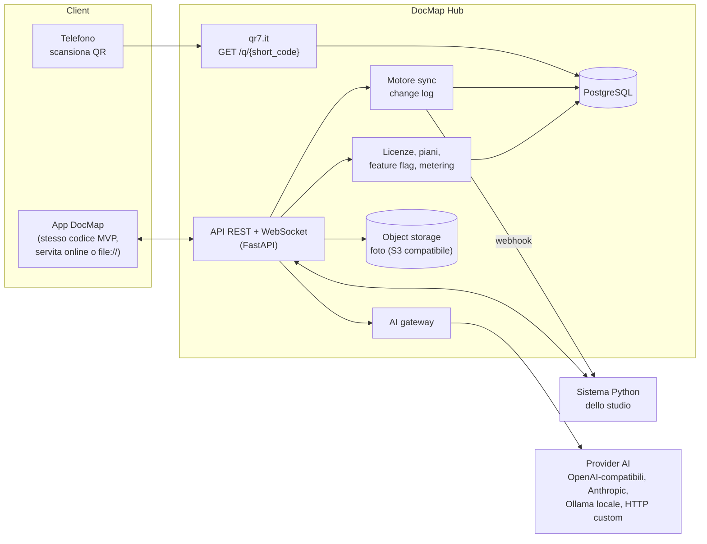

# DocMap Hub e API — progetto per il futuro

> **NON IMPLEMENTATO NELL'MVP.** Questo è un progetto di riferimento per la fase online. L'MVP (v7/v8) resta un'app offline in `file://` senza server. Nulla di quanto segue esiste ancora nel codice; i nomi dei campi però sono già quelli di `MODELLO-DATI.md` e non vanno cambiati.

## 1. Obiettivi

1. Il QR stampato `https://qr7.it/{short_code}` deve portare, dal telefono, alla destinazione giusta (scheda del faldone, pagina dello studio, documento).
2. L'app (stessa UX dell'MVP) deve funzionare **anche online** e sincronizzarsi in tempo reale con il **sistema Python avanzato** dello studio.
3. Per scelta di progetto: hub centrale con **licenze, abbonamenti e feature flag**, **multi-tenant** e indipendente dal cliente (non legato allo Studio Dall'Asta), chiamate AI tramite un **gateway indipendente dal fornitore** con misurazione dei consumi e ricarico (markup).

## 2. Architettura di destinazione



Scelte consigliate (pragmatiche, già citate da Dave):

| Componente | Scelta | Perché |
|---|---|---|
| Backend | **Python 3.12 + FastAPI** + Pydantic | stesso linguaggio del sistema dello studio; OpenAPI generata da sola |
| Database | **PostgreSQL** (SQLAlchemy + Alembic) | multi-tenant con Row Level Security, JSONB per impostazioni |
| Foto | object storage S3 compatibile (es. MinIO in sede o provider UE) | le foto oggi sono BLOB in SQLite; nell'hub diventano oggetti con URL firmati |
| Tempo reale | WebSocket (o SSE) sullo stesso FastAPI | notifica "ci sono modifiche" ai client collegati |
| Code / job | Redis + RQ/Celery (solo quando serve) | webhook in uscita, import grandi, AI |
| Frontend | **lo stesso codice dell'MVP** | si aggiunge un modulo `sync` opzionale; offline continua a funzionare |

## 3. Modello multi-tenant

```
tenant (studio)  1─*  user  *─*  role          tenant 1─* binder 1─* contents_item
tenant 1─* client      tenant 1─* photo        tenant 1─1 subscription *─1 plan
tenant 1─* api_key     tenant 1─* webhook      tenant 1─* usage_event
```

- **tenant**: `id`, `slug`, `name`, `settings` (JSONB = `settings` dell'MVP), `short_code_prefix` (oggi `dm26`; un prefisso per tenant evita collisioni future), `created_at`.
- **user**: `id`, `tenant_id`, `email`, `name`, `status`; autenticazione OIDC o password + 2FA.
- **ruoli**: `owner` (abbonamento, chiavi), `admin` (utenti, impostazioni), `operator` (crea/modifica faldoni, stampa), `viewer` (sola lettura), `scanner` (solo vista del QR scansionato).
- Tutte le tabelle di dominio hanno `tenant_id`; RLS su Postgres impone l'isolamento. Gli `id` restano gli UUID generati dal client (nessuna rinumerazione).
- Unicità: `(tenant_id, speaking_code)`, `short_code` **globale** (è un URL pubblico), `(tenant_id, id)`.

## 4. Protocollo di sincronizzazione (offline-first)

Regole di base, compatibili con i dati dell'MVP:

1. Ogni record (binder, client, contents_item, photo) ha `id` UUID creato dal client, `updated_at` ISO UTC, e nell'hub anche `version` (intero incrementato dal server) e `deleted_at` (tombstone, mai cancellazione fisica immediata).
2. **Outbox locale**: il client registra ogni modifica (`op: upsert|delete`, `entity`, `id`, `base_version`, `payload`, `client_ts`). Oggi l'MVP riscrive tutto lo specchio SQLite: in v9 si aggiunge una tabella `outbox` alimentata da `commit()`.
3. **Push**: `POST /v1/sync/push` con un lotto di modifiche; il server applica in transazione e risponde con le nuove `version` o con i conflitti.
4. **Pull**: `GET /v1/sync/pull?since=<cursor>` restituisce le modifiche (di tutti i dispositivi e del sistema Python) dopo il cursore, più il nuovo cursore. Il WebSocket invia solo "nuovo cursore disponibile".
5. **Conflitti** (stessa entità modificata su due lati dalla stessa `base_version`):
   - di default **per campo, vince l'`updated_at` più recente** (last-writer-wins per campo); `contents_items` si fondono per `(binder_id, position)` → in v9 voci con proprio `id`;
   - `id`, `short_code`, `created_at` **non si sovrascrivono mai**;
   - conflitto su `speaking_code` (due faldoni con lo stesso codice) → il secondo viene rinominato con `suggestSpeakingCode` e il conflitto è registrato e mostrato all'utente;
   - eliminazione contro modifica → vince la modifica, il record torna attivo e l'utente viene avvisato.
6. Il **sistema Python** è un client come gli altri (stesse API push/pull) oppure riceve webhook (§7). Il modello dell'MVP è quello di riferimento.

## 5. Risoluzione dei QR

```
GET https://qr7.it/{short_code}          (alias: GET /q/{short_code})
  → 302 Location: <destinazione finale>
```

- Ricerca per `short_code`: destinazione = `final_destination` personalizzata oppure `tenant.settings.destTemplate` con gli stessi segnaposto dell'MVP (`{speaking_code} {multi_code} {short_code} {company} {location} {id}`).
- Codici non `dm26` (es. `1TSE0G`, `Oliva01`) continuano a essere serviti dal manifest esistente: l'hub importa `manifest.csv` come tabella `redirect(short_code, final_destination, tags)`.
- Codice sconosciuto → 404 con pagina neutra; faldone eliminato → 410 o pagina "faldone archiviato" (il codice resta riservato, mai riassegnato).
- **Log delle scansioni**: `scan(id, short_code, tenant_id, at, user_agent, ip_hash, country, user_id?)`; IP salvato solo come hash con sale ruotato (GDPR). Utile per "ultimo visto", statistiche e controllo prelievi.
- Destinazione consigliata: `https://<hub>/b/{short_code}` → pagina mobile del faldone (posizione, contenuti, foto, pulsante "Prelevo / Restituisco" che cambia `archive_state` del faldone o `contents_items[].status` delle voci, `archive` ↔ `in_use` / `client`) visibile solo a utenti autenticati del tenant; agli altri solo un messaggio generico, **mai dati del cliente**.
- Il manifest CSV di oggi resta come formato di esportazione e di emergenza.

## 6. API REST (bozza)

Base `https://<hub>/v1`, JSON UTF-8, autenticazione `Authorization: Bearer <token utente>` oppure `X-Api-Key` (integrazioni). Paginazione `?limit=&cursor=`; filtro `?updated_since=`. Concorrenza ottimistica con `If-Match: <version>`.

| Metodo e percorso | Uso |
|---|---|
| `GET /binders?q=&state=&room=&category=&multi_code=` | elenco/ricerca (stessi campi della ricerca MVP) |
| `GET /binders/{id}` · `GET /binders/by-code/{speaking_code}` · `GET /binders/by-short/{short_code}` | dettaglio |
| `POST /binders` · `PUT /binders/{id}` · `PATCH /binders/{id}` · `DELETE /binders/{id}` | scrittura (il server applica `normalizeBinder` lato Python e `ensureIntegrity`) |
| `POST /binders/import` | CSV (27/25 colonne di backup o 22/20 del modello AI) o workspace JSON, modalità `merge` / `replace`, risposta = anteprima come nell'MVP (`new`/`upd`/`err` con avvisi) se `dry_run=true` |
| `GET /binders/export.csv` · `/export/manifest.csv` · `/export/workspace.json` · `/export/docmap.sqlite` | gli stessi file dell'MVP |
| `GET/POST/PUT/DELETE /clients` · `POST /clients/import` | anagrafica (alias di `CLIENT_ALIASES`) |
| `GET/PUT /binders/{id}/contents` | voci di contenuto (array ordinato) |
| `POST /photos` (multipart) · `GET /photos/{id}` (URL firmato) · `PATCH /photos/{id}` · `DELETE` | foto, `owner_type` `binder`/`cabinet`, `owner_key`, `caption`, `marks` |
| `GET/POST /sessions` · `POST /sessions/{id}/restore` | istantanee con nome |
| `POST /short-codes` | riserva N short code nuovi (per client offline e sistema Python) |
| `POST /sync/push` · `GET /sync/pull` · `WS /sync/live` | §4 |
| `GET /scans?short_code=&from=&to=` | log scansioni |
| `POST /ai/run` · `GET /ai/usage` | §9 |

Esempio di faldone (stessa forma di `MODELLO-DATI.md` §8, più i campi di hub):

```json
{
  "id": "8d0c2f0e-5b7a-4a51-9a1e-0f3c6d2b7e11",
  "tenant_id": "c7f3…",
  "version": 12,
  "speaking_code": "BL1", "multi_code": "M-10234",
  "company_name": "Barbieri Luigi S.r.l.", "company_city": "Parma (PR)",
  "category": "Ordinaria", "color_hex": "#2563EB", "binder_title": "Fatture e Contabilità IVA",
  "ref_year": "2025", "extra_codes": "",
  "room_code": "A", "cabinet_code": "1", "shelf_code": "α", "sector_code": "", "shelf_color": "",
  "location_code": "A1-α", "archive_state": "CURRENT",
  "contents_items": [{"year": "2025", "description": "Fatture Acquisto Q1-Q4", "status": "archive"}],
  "tags": "iva,fatture,2025", "contacts": "", "notes": "",
  "short_code": "dm26K8m2P9xL", "short_url": "https://qr7.it/dm26K8m2P9xL",
  "final_destination": "", "resolved_destination": "https://docmap.pr-it.it/studio-de/q/dm26K8m2P9xL",
  "selected_for_print": true,
  "created_at": "2026-10-31T09:12:44.120Z", "updated_at": "2026-10-31T09:12:44.120Z", "deleted_at": null
}
```

Errori: `{"error": {"code": "duplicate_speaking_code", "message": "…", "field": "speaking_code"}}` con HTTP 400/404/409/422.

## 7. Integrazioni: webhook in uscita e chiavi in entrata

- **Webhook in uscita** (per tenant): eventi `binder.created|updated|deleted`, `client.*`, `photo.*`, `scan.created`, `import.completed`. Corpo `{event, tenant_id, id, version, at, data}`; firma `X-DocMap-Signature: sha256=<HMAC del corpo>`; tentativi con backoff esponenziale, coda di eventi falliti consultabile.
- **Chiavi API in entrata**: create dall'owner, con scope (`binders:read`, `binders:write`, `clients:write`, `scans:read`, `ai:run`…), scadenza, ultimo uso, revoca. Il sistema Python usa una chiave dedicata.
- **Connettori** futuri (gestionale, DMS, firma, PEC) come servizi separati che parlano solo l'API pubblica.

## 8. Licenze, abbonamenti, feature flag

```
plan(id, name, price_month, limits_json, features_json)
subscription(tenant_id, plan_id, status: trial|active|past_due|cancelled, period_end, seats)
feature_flag(key, default, rollout_json)        tenant_flag(tenant_id, key, value)
licence(tenant_id, key, offline_valid_until, signature)
```

- Limiti esempio: numero faldoni, utenti, GB di foto, crediti AI mensili, webhook.
- Feature flag lette dall'app all'avvio (`GET /v1/me` → `features`), con default sicuri **offline**: l'MVP in `file://` continua a funzionare senza hub; una licenza firmata (Ed25519) con scadenza consente l'uso offline per un periodo.
- Pagamenti tramite un provider esterno (es. Stripe) con webhook verso il hub; nessun dato di carta nel hub.

## 9. Gateway AI indipendente dal fornitore

Oggi l'MVP **non chiama nessuna AI**: copia negli appunti un prompt (`buildAIPrompt`) che l'utente incolla in ChatGPT/Claude/Gemini, poi reimporta il CSV. Il gateway rende lo stesso flusso automatico.

- **Registro dei provider** (`ai_provider`): `type` ∈ `openai_compatible` (OpenAI, Azure, Mistral, Groq, vLLM, LM Studio…), `anthropic`, `ollama` (locale, gratuito), `custom_http` (URL + mappatura JSON di richiesta/risposta); `base_url`, `models`, prezzi per 1M token in ingresso/uscita, capacità (vision, JSON mode).
- **Chiavi**: del tenant (BYOK, cifrate con KMS) oppure del hub (consumo fatturato). Priorità e fallback configurabili per tenant.
- **Interfaccia unica**: `POST /v1/ai/run {template, inputs, attachments, provider?, model?}` → `{output, parsed, usage}`. Il backend adatta il formato per provider.
- **Template di prompt** versionati, a partire da quelli esistenti: `binders_from_notes` (= prompt CSV a 22 colonne della v8 con le stesse regole: niente dati inventati, Codice Multi copiato esattamente o vuoto), `binders_from_shelf_photo`, `contents_from_scan`, `client_match`. L'output passa dallo **stesso import** (anteprima nuovo/aggiorna/errore, merge) prima di toccare i dati.
- **Misurazione** (`usage_event`): `tenant_id, user_id, provider, model, template, tokens_in, tokens_out, cost_provider, markup_pct, cost_billed, latency_ms, status, at`. Prezzo = costo provider × (1 + markup), oppure crediti del piano. Le chiamate a provider locali possono avere un costo fisso o zero.
- **Chiamate in entrata**: altri sistemi possono usare il gateway via chiave API con scope `ai:run`, misurati allo stesso modo.
- Privacy: per tenant si può limitare l'AI a provider locali/UE e disattivare l'invio di foto; i log conservano metadati, non i contenuti (salvo opzione esplicita).

## 10. Sicurezza e GDPR (dati di uno studio italiano)

- I dati sono di clienti dello studio (ragioni sociali, codici fiscali/pratiche, contenuti di dichiarazioni): lo studio è **titolare**, il fornitore del hub è **responsabile del trattamento** (art. 28 GDPR) → contratto DPA, registro dei trattamenti, elenco dei sub-responsabili (hosting, storage, provider AI).
- Hosting e backup **nell'UE**; cifratura in transito (TLS) e a riposo; backup cifrati con test di ripristino.
- Minimizzazione: la pagina pubblica del QR non mostra dati personali; log delle scansioni con IP con hash; conservazione limitata (es. 12 mesi).
- Controllo accessi per ruolo, 2FA per owner/admin, audit log di ogni modifica (chi, quando, prima/dopo), esportazione completa dei dati del tenant (diritto di portabilità) e cancellazione su richiesta.
- **Audit trail già pronto nell'MVP (v9)**: il registro attività locale (`activity_log`, `MODELLO-DATI.md` §7.2) ha già la forma di una riga di audit dell'hub: `id` uuid, `at` ISO UTC, `who`, `action` stabile (`binder.edit`, `import.merge`, …), `target {type, id, code}`, `summary`, `details` (diff campo → [prima, dopo]), `source`. Nell'hub: `who` diventa l'`user_id` autenticato (oggi è il nome scritto in Impostazioni, o "Questo PC"), si aggiungono `tenant_id` e `device_id`, le righe arrivano con il push di sincronizzazione (`POST /v1/sync/push`, entità `activity`, solo inserimento, mai modificate) e si leggono con `GET /v1/activity?from=&to=&who=&action=&target_id=`. Le righe locali hanno `id` univoci, quindi l'unione di più PC è senza conflitti.
- AI: nessun addestramento sui dati del tenant (scegliere provider con questa garanzia), opzione "solo locale" (Ollama).
- Conservazione documentale: DocMap gestisce la **posizione** di documenti cartacei, non sostituisce la conservazione sostitutiva a norma.

## 11. Roadmap a fasi

| Fase | Contenuto | Note |
|---|---|---|
| **v7–v8 (oggi)** | MVP offline: archivio, stampa, QR statici, SQLite locale, export CSV/JSON/manifest/.sqlite; v8 aggiunge contatti, note, stato voci, import Excel, hub Informazioni | il sistema Python si allinea leggendo gli export (`ALLINEAMENTO-PYTHON.md`) |
| **v9 — prepara la sync** | `outbox` locale, `version`/`deleted_at` nel modello, voci di contenuto con `id` proprio, `client_id` facoltativo sul faldone, riserva di blocchi di short code | tutto ancora offline, retro-compatibile |
| **Hub 1 — redirect** | FastAPI + Postgres; `GET /q/{short_code}` con log scansioni; import del manifest; pagina mobile del faldone (sola lettura) | sostituisce il manifest statico |
| **Hub 2 — API + sync** | autenticazione, tenant unico (Studio Dall'Asta), API REST, push/pull + WebSocket, foto su object storage, webhook verso il sistema Python | l'app MVP diventa "online-capable" |
| **Hub 3 — multi-tenant** | tenant, ruoli, RLS, piani, feature flag, licenze offline, chiavi API | prodotto vendibile ad altri studi |
| **Hub 4 — AI gateway** | registro provider, template, metering con markup, BYOK, provider locali | il pulsante "Genera con AI" chiama il gateway |

## 12. v10: seam già pronti nel front-end

Il front-end ha già le interfacce che il back-end deve soddisfare (`assets/js/10-auth.js`), con implementazione
locale oggi e stub remoti pronti:

| Interfaccia | Locale (MVP) | Remota (back-end) |
|---|---|---|
| `AuthProvider` (`login · logout · currentUser · getToken · onChange · can`) | `LocalAuthProvider`: utenti PBKDF2 in `localStorage 'docmap_v26_auth'` | `RemoteAuthProvider`: `POST /v1/auth/token` (o OIDC) |
| `DataProvider` (`getBinderByQr · getBinderByCode · saveBinderPatch · listChanges · getCabinetPhoto · context`) | `LocalDataProvider`: stesso stato del desktop (o la cassaforte in modalità web) | `RemoteDataProvider`: `GET /v1/binders/by-short/…`, `PATCH` con `If-Match` |
| `CryptoProvider` (`encrypt · decrypt · sha256`) | AES-256-GCM a busta, KEK non estraibile in IndexedDB | KMS per tenant |
| `BlobStore` (`putBlob · getBlob · deleteBlob · listBlobs`) | IndexedDB `docmap_v26_blobs`, cifrato | `POST /v1/blobs` + object storage |

Contratto completo: `API-CONTRACT.md`. Modello di sicurezza: `SICUREZZA.md`. Pubblicazione statica: `DEPLOY-WEB.md`.
La pagina mobile del QR è `scan.html` (`11-scan.js`); la destinazione predefinita è `https://docmap.pr-it.it/studio-de/q/{short_code}`.


## Fase successiva: mappatura location con QR location

Rimandata dopo l'MVP. La posizione resta facoltativa nei campi `room_code`, `cabinet_code`, `shelf_code`, `sector_code` e `location_code`. Il progetto per la fase successiva prevede quattro elementi:

1. **Tabella gerarchica** `locations(id, parent_id, kind, code, name, qr_short_code)`.
2. **QR location**: un tipo di QR distinto da quello del faldone.
3. **Scansione in "ascolto" da mobile**: si inquadra un QR location e poi i QR dei faldoni. Ogni faldone inquadrato viene assegnato a quella location finché non si inquadra la location successiva.
4. **Inserimento manuale e import CSV**, che restano disponibili.

Le assegnazioni finiscono in `activity_log`. Vedi anche `docs/HANDOFF_PROMPT.md` §3b.
